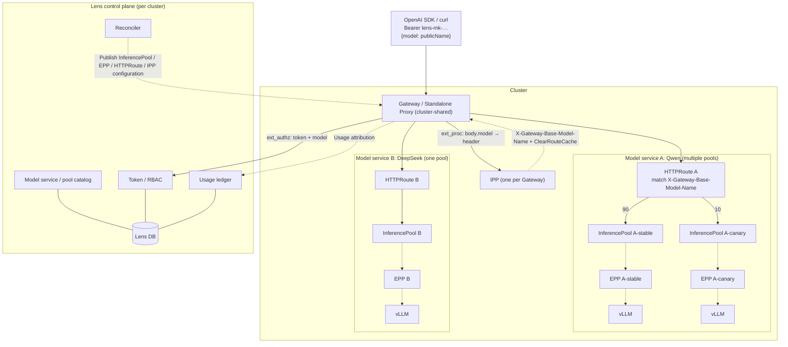
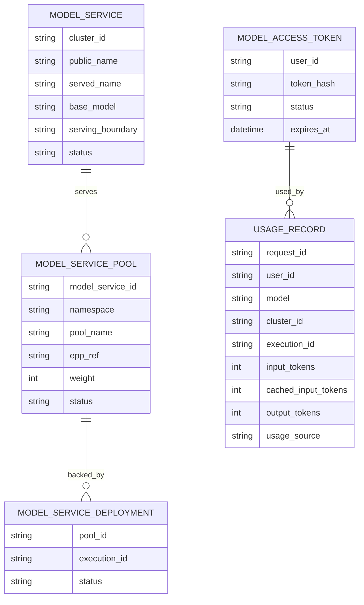

# Model Service Design

Model services use per-cluster native llm-d Gateway Mode: one shared cluster
Gateway and IPP, deployment-owned InferencePool/EPP, and model-service-owned
HTTPRoute publication. Lens owns catalog, authorization, tokens, reconciliation
and usage attribution, not cross-cluster inference routing.

This is the single canonical design for this module. Section numbers retain
their original part-local context; use the links below for unambiguous
navigation.

- **Part:**
  [Native llm-d routing](#lens-model-service-design-per-cluster-native-llm-d);
  **Scope and status:** Current per-cluster routing and control-plane ownership.
- **Part:**
  [Gateway deployment and operations](#model-service-gateway-deployment-and-operations-guide-llm-d-gateway-mode);
  **Scope and status:** Deployment layers, configuration, acceptance and
  troubleshooting.

<!-- design-part: gateway-mode -->

## Lens Model Service Design (Per Cluster, Native llm-d)

Each cluster exposes its own OpenAI-compatible endpoint. The community llm-d
data plane (Gateway/Proxy + IPP + InferencePool + EPP) serves every model
service in that cluster. Lens supplies only control-plane capabilities absent
from the community stack.

### 1. Goals and scope

- Configure services per cluster; users call the cluster endpoint by model name.
- Multiple models and LoRA within one cluster.
- User tokens, model-service authorization, and cluster-specific visible models.
- Usage ledger by user/model/cluster and four token categories.

Out of scope: cross-cluster routing, custom Lens proxies/schedulers,
quotas/billing, and rate limits. Community HTTPRoute owns weighted multi-pool
splitting; Lens only renders configuration.

### 2. Design principles

- Reuse community capabilities; implement only missing capabilities in Lens.
- Lens does not carry inference bytes or select endpoints/replicas.
- Publish standard llm-d / GAIE / Gateway API resources only.
- Keep cluster boundaries. Each EPP serves one InferencePool; one HTTPRoute
  distributes requests across deployment-owned pools using Gateway API backend
  weights.

### 3. Capability ownership

- **Capability:** Gateway/Proxy, TLS, HA; **Owner:** Community + provider
- **Capability:** Multi-model/LoRA payload routing; **Owner:** Community IPP
- **Capability:** Pool endpoint set; **Owner:** Community InferencePool
- **Capability:** Load/KV/prefix endpoint scheduling; **Owner:** Community EPP
- **Capability:** Model-name rewriting; **Owner:** Community
  InferenceModelRewrite
- **Capability:** Charts/CRDs; **Owner:** Community `llm-d-router-*`,
  `payload-processor`
- **Capability:** Usage/metrics; **Owner:** Community Envoy/EPP/vLLM metrics
- **Capability:** Model catalog/publication; **Owner:** Lens
- **Capability:** Token issuance/validation; **Owner:** Lens
- **Capability:** Model-service authorization/visibility; **Owner:** Lens
- **Capability:** Usage ledger; **Owner:** Lens
- **Capability:** Publication reconciliation/audit/lifecycle; **Owner:** Lens
- **Capability:** UI/documentation; **Owner:** Lens

### 4. Overall architecture



One shared Gateway per cluster; each deployment provides its own `InferencePool`
\+ EPP without a proxy. Each model service gets one HTTPRoute referencing its
positive-weight pools. Solid arrows show routing/data; dashed arrows show
ext_proc/control interactions.

#### Model service topology presentation

Within each cluster, show one public-model frame with one HTTPRoute and one or
more deployment frames. Label each deployment frame with its deployment name and
group its InferencePool, EPP, and model server without internal connector lines.
Connect HTTPRoute to deployment frame boundaries using a shared branch; do not
duplicate HTTPRoute for each provider.

Branches show configured request shares, not measured traffic. Zero-weight and
disabled providers retain deployment frames with 0% and dotted connections. The
three-line menu beside the model name contains **Traffic distribution**, which
opens a full-height drawer with relative weights, calculated shares and a
compatible ready-deployment selector.

The model menu also provides **Stop serving / Resume serving**, persisting the
group's existing `active`/`disabled` status. Deployment-name menus provide
**Take offline / Bring online**, using member status without changing weight or
scaling workloads. Online at weight 0 remains standby. Resuming a group never
enables offline members, and enabling a member never resumes its stopped group.
All providers may be offline; no eligible pool means no HTTPRoute.

PATCH group/member handlers await routing reconciliation and report a persisted
state separately from apply failures (`502 model_publication_apply_failed`).
Health probes skip stopped groups/offline members; health-only DAO writes lock
the member row and cannot overwrite a concurrent offline decision. Auto-healing
requires an enabled model with a positive-weight online provider. Missing routes
for a model without routed providers are intentional, not a reason to reinstall.

#### Weighted traffic distribution

The user approved adding `model_service_members.weight` and the migration while
requesting multi-deployment HTTPRoute routing. This supersedes the previous Lens
first-published-pool restriction; it does not change EPP's one-pool ownership.

The column is a non-null integer, default 1, with a database range check of 0
through 1,000,000. The range and 16-backend limit come from upstream
[Gateway API BackendRef](https://github.com/kubernetes-sigs/gateway-api/blob/main/apis/v1/shared_types.go)
and
[HTTPRouteRule](https://github.com/kubernetes-sigs/gateway-api/blob/main/apis/v1/httproute_types.go).
The llm-d
[blue-green rollout guide](https://github.com/llm-d/llm-d/blob/f83d4f331ec87a82fa11c84449738705ac4d1424/guides/rollouts/blue-green-update.md)
demonstrates a single route with 90/10 InferencePool backends.

Migration `c21490d948bb` was autogenerated and reviewed, joins the two existing
migration heads, and preserves the old routing choice: the first non-disabled
resolvable member ordered by ID within each group/cluster receives 1; all others
receive 0. Every new provider defaults to 1; existing weights remain unchanged.
Zero-weight associations remain saved but are omitted from HTTPRoute
backendRefs. An existing zero-weight pool without Gateway parent status is
`standby`, not `degraded`, and does not by itself trigger Gateway/IPP
auto-healing. Endpoint health is still checked; missing pools, explicit
rejection, and positive-weight pools without parent acceptance are not treated
as standby. Unhealthy positive-weight members remain eligible for reconciliation
so a missing route does not prevent the route from ever being created.

`PUT /admin/groups/{group_id}/traffic` atomically saves the complete weight set
and new providers. Its `expectedWeights` snapshot rejects stale membership or
weights with 409. Group/member locks serialize member creation and traffic
saves; health updates do not overwrite weights. New providers, and providers
activated from zero, must be ready llm-d deployments in the same cluster with
matching provider model names. Allocations require at least one enabled positive
weight.

Save commits before reconciliation. A failed apply leaves the desired allocation
saved and reports that explicitly; Reconcile retries it. Reconciles are
serialized per cluster within the current single control-plane process.
Submission success does not establish controller acceptance or an observed
statistical traffic split. This does not implement automatic failover,
request-body model rewriting, or weights based on tokens, latency, compute
capacity or endpoint replica count.

### 5. Cluster preparation and versions

Data-plane components have three layers:

- **Shared cluster (at cluster creation):** Gateway API / GAIE CRDs, provider,
  **Gateway**, IPP.
- **Deployment:** model server + EPP + InferencePool, 1:1, no Gateway/proxy.
- **Model service (at publication):** HTTPRoute and IPP model mapping,
  referencing the cluster Gateway and deployment pool.

Pin versions alongside llm-d/llm-d-benchmark in the cluster wizard Software
versions step:

- **Component:** llm-d (local Lens use); **Version field:** `llm_d_ref`;
  **Source:** Source checkout

- **Component:** llm-d-benchmark (local use); **Version field:**
  `llm_d_lensmark_ref`; **Source:** Source checkout

- **Component:** Gateway provider; **Version field:** `gateway_provider` +
  `gateway_version`; **Source:** Helm chart / CRD

- **Component:** GAIE / Gateway API CRDs; **Version field:** `gie_version`;
  **Source:** Official manifests

- **Component:** llm-d Router (EPP / Proxy); **Version field:**
  `router_version`; **Source:** Helm chart / image

- **Component:** IPP; **Version field:** `ipp_version`; **Source:** Helm chart /
  image

- IPP/Router/provider are cluster components installed as charts/images, not
  local source caches.

- Select and validate pinned compatible version sets across IPP ↔ Router ↔ GIE ↔
  provider ↔ Kubernetes.

#### 5.1 Gateway and Deployment semantics

- **Start the shared Gateway at cluster creation:** install Gateway API/GAIE
  CRDs, provider, Gateway, and IPP (§5), one Gateway per cluster.
- **Deployments do not start their own Gateway/proxy:** use the shared Gateway.
- **Deployments retain their EPP + InferencePool:** create together, EPP:pool
  1:1, chart proxy disabled. Pool selectors select pods; scaling changes only
  pod counts.
- **Model services generate HTTPRoute:** `parentRefs` targets the cluster
  Gateway; `backendRefs` lists the positive-weight, non-disabled pools, with one
  IPP model mapping.

Deployment order: create pool/EPP and wait for readiness, then publish the model
service HTTPRoute.

### 6. Domain model



- `public_name`: model name requested by users.
- `served_name`: model name accepted by the downstream engine.
- `base_model`: IPP model-mapping pool key for LoRA; equals served_name without
  LoRA.
- `serving_boundary`: `gateway` (Gateway API) or `standalone` (Proxy sidecar).
- `MODEL_SERVICE_POOL`: logical deployment-owned InferencePool+EPP binding, with
  its relative request weight.
- `MODEL_SERVICE_DEPLOYMENT`: deployment backing a pool, for display and usage
  attribution.

The diagram describes logical resources. The implemented persistence model uses
`model_service_groups` and `model_service_members`, not separate pool/deployment
tables:

- **Table:** `model_service_groups`; **Current contract:** Public model name,
  cluster, served/base model, display metadata and status.
- **Table:** `model_service_members`; **Current contract:** Group-to-execution
  association, cluster/target service, pool/EPP references, relative weight,
  ownership and health.
- **Table:** `model_access_tokens`; **Current contract:** User-owned token
  hash/hint, status, expiry, revocation and last-use metadata; never plaintext.
- **Table:** `usage_records`; **Current contract:**
  Request/user/model/cluster/execution attribution and token counts; not a
  billing ledger.

The ORM definitions under
[`apps/backend/src/llm_d_lens/db/models/`](../../apps/backend/src/llm_d_lens/db/models)
own exact columns and constraints. Services use the matching DAOs; schema edits
follow the [database design](database-design.md).

### 7. Request flow

```mermaid
sequenceDiagram
    participant C as Client
    participant GW as Gateway / Standalone Proxy
    participant IPP as IPP
    participant AUTH as Lens ext_authz
    participant EPP as EPP
    participant V as vLLM
    C->>GW: POST /v1/chat/completions (Bearer lens-mk-…)
    GW->>IPP: ext_proc
    IPP-->>GW: X-Gateway-Model-Name / Base-Model-Name + ClearRouteCache
    GW->>AUTH: ext_authz (token + model headers)
    AUTH->>AUTH: token→user; model→service in this cluster; check access
    alt Invalid token / denied
        AUTH-->>GW: 401 / 404
    else Allowed
        AUTH-->>GW: Identity headers
        GW->>GW: HTTPRoute by Base-Model-Name → InferencePool
        GW->>EPP: ext_proc
        EPP-->>GW: x-gateway-destination-endpoint
        GW->>V: Forward; return SSE
        GW--)AUTH: Usage attribution
    end
```

### 8. Authorization

Standard Envoy **ext_authz** points to Lens; no custom ext_proc or subset.

- Input: Authorization and IPP-injected X-Gateway-Model-Name.
- Processing: validate token → resolve public_name within the cluster → check
  access.
- Output: identity headers (hashed x-lens-user-id); no destination.
- Rejection: 401/404, without distinguishing missing resources from forbidden
  ones.

Authorization is at **model-service level**; EPP owns endpoint selection. For
Gateway-backed services, callers must be authorized for **every attached
deployment**, including zero-weight and disabled providers. This conservative
boundary prevents a pending/failed traffic update from admitting callers based
only on a new allocation while the proxy still uses an older one. At least one
active positive-weight provider is also required. Lens's legacy authorization
result member is not evidence of which pool the Gateway actually selected.

### 9. Control-plane components

- **Module:** Catalog; **Responsibility:** Per-cluster service/pool CRUD;
  associate deployments with pools at publication; derive
  served_name/serving_boundary
- **Module:** Tokens; **Responsibility:** Issue/revoke/reset; plaintext shown
  once
- **Module:** Authz; **Responsibility:** Model-service authorization; identical
  visibility and invocation rules
- **Module:** Reconciler; **Responsibility:** Render/apply community resources,
  wait for readiness, audit
- **Module:** Usage; **Responsibility:** Collect community usage, attribute by
  execution, persist idempotently
- **Module:** Visibility API; **Responsibility:** Per-cluster `/v1/models`
  returns only public_name values visible to this token in that cluster

`ModelTokenService` reuses the auth domain's random-token and SHA-256 primitives
but keeps model tokens in a separate namespace/table from login sessions. Tokens
use the `lens-mk-` prefix; creation/reset returns plaintext once, while
persistence retains the hash and a last-four-character hint. Validation rejects
inactive or expired tokens. Resetting a selected token revokes that token;
resetting without an ID revokes all active tokens for the user before creating a
new one. Last-use metadata is touched at most once per 60 seconds. The current
management APIs and UI are documented in the
[Model services API manual](../site/i18n/en/docusaurus-plugin-content-docs/current/api-reference/modules/model-services.mdx)
and
[user guide](../site/i18n/en/docusaurus-plugin-content-docs/current/user-guide/model-services.mdx).

### 10. Published resources

Each deployment provides its own InferencePool + EPP (§5.1). Model publication
creates one HTTPRoute (`parentRefs` → cluster Gateway; weighted `backendRefs` →
deployment pools) and one IPP model mapping:

```yaml
# Provided by deployment (one set per deployment)
apiVersion: inference.networking.k8s.io/v1
kind: InferencePool
metadata: { name: qwen, namespace: inference }
spec:
  selector: { matchLabels: { llm-d.ai/model: qwen, llm-d.ai/pool: stable } }
  targetPorts: [{ number: 8000 }]
  endpointPickerRef:
    name: qwen-epp
    port: { number: 9002 }
    failureMode: FailClose
---
apiVersion: inference.networking.k8s.io/v1
kind: InferencePool
metadata: { name: qwen-new, namespace: inference }
spec:
  selector: { matchLabels: { llm-d.ai/model: qwen, llm-d.ai/pool: canary } }
  targetPorts: [{ number: 8000 }]
  endpointPickerRef:
    name: qwen-new-epp
    port: { number: 9002 }
    failureMode: FailClose
---
# Published by model service
apiVersion: gateway.networking.k8s.io/v1
kind: HTTPRoute
metadata: { name: qwen, namespace: inference }
spec:
  parentRefs: [{ name: llm-d-inference-gateway }]
  rules:
    - matches:
        - headers:
            - type: Exact
              name: X-Gateway-Base-Model-Name
              value: "Qwen/Qwen3-32B"
      backendRefs:
        - group: inference.networking.k8s.io
          kind: InferencePool
          name: qwen
          weight: 90
        - group: inference.networking.k8s.io
          kind: InferencePool
          name: qwen-new
          weight: 10
```

```yaml
apiVersion: v1
kind: ConfigMap
metadata:
  name: qwen-model-map
  namespace: inference
  labels: { inference.llm-d.ai/ipp-managed: "true" }
data:
  baseModel: "Qwen/Qwen3-32B"
  adapters: |
    - food-review-1
---
apiVersion: llm-d.ai/v1alpha1
kind: PayloadProcessorConfig
metadata: { name: ipp, namespace: inference }
spec:
  plugins:
    - type: body-field-to-header
      parameters:
        fieldName: model
        headerName: X-Gateway-Model-Name
    - { type: base-model-to-header }
  profiles:
    - name: default
      plugins:
        request:
          - { pluginRef: body-field-to-header }
          - { pluginRef: base-model-to-header }
```

One Gateway serves multiple models. Each model has one HTTPRoute referencing one
or more InferencePools, each with its own EPP.

Layering: Gateway owns weighted cross-pool request selection. Within a pool, EPP
performs inference-aware `Filter→Score→Pick` scheduling for KV/queue/prefix.
Lens renders weights and model mapping, not scheduling logic.

### 11. My services page

- Group services by cluster, displaying public_name, status, and invocation
  examples.
- Show each cluster's own base URL/examples; call that cluster's endpoint.
- User-level tokens work across clusters; visible models are filtered by user +
  cluster.

### 12. Health and lifecycle

Publication flow:

```text
Select cluster + deployment (already supplies InferencePool + EPP)
 -> Derive serving contract (served_name)
 -> Render/apply HTTPRoute + IPP configuration
 -> Wait for Gateway / HTTPRoute / InferencePool readiness
 -> Probe the model
 -> Mark Ready
```

- **Dimension:** Configuration ready; **Evidence:** Gateway/HTTPRoute
  conditions, endpointPickerRef, selector
- **Dimension:** Transport reachable; **Evidence:** Gateway listener, DNS,
  certificate, readiness
- **Dimension:** Pool available; **Evidence:** EPP candidates and ready model
  server
- **Dimension:** Correct model; **Evidence:** Served-name/adapter probe

Disable/delete/update handle desired/observed revisions and draining. Deleting
one model does not uninstall shared Gateway/IPP.

### 13. Usage

- Collection: reuse Envoy/engine/EPP usage and metrics.
- Attribution: record the final selected execution; use the known granularity
  when uncertain.
- Idempotency: deduplicate by request_id; without engine usage mark
  `usage_source=estimated`.

Persist input, cached-input, cache-write and output token counts separately.
Keep request count, status, streaming flag, timing and evidence source alongside
the attribution. Quotas, balances, prices and rate limits are outside this
design.

### 14. Error contract

| Condition               | Response |
| ----------------------- | -------- |
| Invalid/revoked token   | 401      |
| Missing/forbidden model | 404      |
| No healthy destination  | 503      |
| Body too large          | 413      |

Do not replay generative requests unconditionally. Once SSE output starts,
failure terminates that stream.

### 15. Implementation boundaries

The operations part below owns supported provider setup and known gaps.
Acceptance criteria describe the required contract; they do not imply that
unimplemented provider TLS, HA or draining paths are already available.

### 16. Acceptance

- **Case:** Multiple models + LoRA in one cluster; **Expected:** Public name →
  IPP → base model → correct pool; body.model retains adapter
- **Case:** Multiple members for one model; **Expected:** One HTTPRoute
  references positive-weight pools with exact configured weights; disabled/zero
  providers receive no new traffic after the update takes effect
- **Case:** Long prompt; **Expected:** Correct body bounds; IPP supplies model
  header
- **Case:** Cluster visibility; **Expected:** Each cluster's `/v1/models`
  returns only models visible to the token there
- **Case:** Provider wiring; **Expected:** HTTPRoute → InferencePool → EPP
- **Case:** Metric association; **Expected:** Each pool uses its own EPP load
- **Case:** Publication lifecycle; **Expected:** Traceable desired/observed
  revisions; no false Ready; deletion retains shared Gateway/IPP
- **Case:** Usage; **Expected:** Execution attribution; correct
  SSE/cancel/failure sources; no duplicate accounting
- **Case:** HA; **Expected:** Consistent authorization/visibility across
  control-plane instances

<!-- /design-part: gateway-mode -->

<!-- design-part: gateway-operations -->

## Model Service Gateway Deployment and Operations Guide (llm-d Gateway Mode)

> Design:
> [`model-service-design.md`](model-service-design.md#lens-model-service-design-per-cluster-native-llm-d).
> This is the Gateway Mode deployment checklist/runbook. The community llm-d
> data plane consists of the shared cluster Gateway, IPP, InferencePool and EPP.
> The control plane and renderers are implemented; actual data-plane
> installation and acceptance require a real cluster.

### 1. Data-plane layers

The three Gateway Mode layers have separate lifecycles:

- **Layer:** Shared cluster; **Created when:** Cluster creation/update;
  **Resources:** Gateway API / GAIE CRDs, provider, **Gateway**, **IPP**;
  **Code:** `llm_d_lens/model_service/gateway_providers.py`
  (`render_inference_gateway`), `gateway_ops.py` (`install_inference_gateway` /
  `install_ipp`)
- **Layer:** Deployment; **Created when:** Deployment creation; **Resources:**
  Model server + EPP + **InferencePool** (1:1, **no own proxy/gateway**);
  **Code:** `llm_d_lens/deploy/...` (disable chart proxy; see
  `router-gateway-mode.values.yaml`)
- **Layer:** Model service; **Created when:** Publication; **Resources:**
  **HTTPRoute**, cross-namespace **ReferenceGrant**, IPP model-mapping
  **ConfigMap**; **Code:** `gateway_providers.py` (`render_model_route`),
  `gateway_ops.py` (`reconcile_cluster_gateway`)

```text
Client ──► Shared cluster Gateway ──► HTTPRoute (base-model match)
                                          │ backendRefs: InferencePool
                                          ▼
                                  InferencePool ──► EPP ──► model server (vLLM)
                    ▲
        IPP (ext_proc: body.model → X-Gateway-Base-Model-Name + ClearRouteCache)
```

One Gateway per cluster; **one HTTPRoute per model service**, whose
`backendRefs` contains weighted InferencePools. llm-d retains one EPP per pool.

### 2. Cluster prerequisites

- Lens backend/database are running, and the target cluster is registered with
  kubeconfig in Lens DB.

- Kubernetes 1.32+ with Gateway API and Gateway API Inference Extension (GAIE,
  `InferencePool` `inference.networking.k8s.io/v1`) CRDs.

- Install the selected **Gateway provider**, configured through
  `gatewayProvider` during cluster creation (§4.1): `gke`, `istio`,
  `agentgateway`, or `envoy-ai-gateway` (default).

- **Envoy AI Gateway requires InferencePool backend support.** Otherwise
  HTTPRoute references are `InvalidKind` (`ResolvedRefs=False`) and requests
  receive 500 direct responses. Include the inference-pool addon when installing
  Envoy Gateway:

  ```bash
  base=https://raw.githubusercontent.com/envoyproxy/ai-gateway/v0.7.0
  helm upgrade -i eg oci://docker.io/envoyproxy/gateway-helm \
    --version v1.8.1 -n envoy-gateway-system --create-namespace \
    -f "$base/manifests/envoy-gateway-values.yaml" \
    -f "$base/examples/inference-pool/envoy-gateway-values-addon.yaml"
  ```

  The addon sets `extensionApis.enableBackend: true`, `extensionManager.hooks`,
  and:

  ```yaml
  extensionManager:
    backendResources:
    - group: inference.networking.k8s.io
      kind: InferencePool
      version: v1
  ```

  > If automation repeatedly runs `helm upgrade eg`, include these values there.
  > Manual edits to `envoy-gateway-system/envoy-gateway-config` are overwritten
  > on upgrade.

- **The cluster must allocate a LoadBalancer address.** With empty
  `status.addresses`, Gateway stays `Programmed=False`
  (`reason=AddressNotAssigned`). Cloud providers allocate addresses; local kind
  requires `cloud-provider-kind` or MetalLB. If installing a load balancer is
  impossible, set **`LENS_GATEWAY_SERVICE_TYPE=NodePort`** and reconcile. Lens
  uses provider-supported Service overrides: `EnvoyProxy` for Envoy AI Gateway;
  a `ConfigMap` referenced by `Gateway.spec.infrastructure.parametersRef` for
  Istio (matching llm-d's `guides/recipes/gateway/istio`).

- **Istio:** install with
  `istioctl install -y --set values.pilot.env.ENABLE_GATEWAY_API_INFERENCE_EXTENSION=true`
  (the llm-d guide pins 1.29.4). Lens renders
  `istio.io/enable-inference-extproc: "true"` on the Gateway; the recipe
  requires it for EPP inference ext_proc.

### 3. Environment variables

- **Variable:** `LENS_IPP_CHART`; **Default:**
  `oci://ghcr.io/llm-d/charts/payload-processor`; **Description:** IPP Helm
  chart path or OCI reference
- **Variable:** `LENS_IPP_VERSION`; **Default:** `v0.1.0`; **Description:** IPP
  chart version; also configurable through cluster `ipp_version`
- **Variable:** `LENS_MODEL_RECONCILE_INTERVAL_SECONDS`; **Default:** `300`;
  **Description:** Background shared-Gateway/model-route reconciliation
  interval, seconds
- **Variable:** `LENS_MODEL_HEALTH_INTERVAL_SECONDS`; **Default:** `10`;
  **Description:** Member backend health-probe interval, seconds; each round
  reprobes HTTPRoute/InferencePool/EPP/model server. Do not set zero, which
  causes busy polling
- **Variable:** `LENS_MODEL_GATEWAY_PUBLIC_URL`; **Default:** Empty;
  **Description:** Gateway entry URL displayed to users
- **Variable:** `LENS_GATEWAY_SERVICE_TYPE`; **Default:** Empty;
  **Description:** `LoadBalancer`/`NodePort`/`ClusterIP` using official provider
  overrides (`EnvoyProxy` for Envoy, ConfigMap parametersRef for Istio). Use
  NodePort without LB; empty retains provider default

### 4. Deployment steps

#### 4.1 Create cluster and install the shared Gateway

New cluster fields (migration `c1f7a2b9d4e6`):

- **Field:** `gateway_provider`; **Description:** `gke` / `istio` /
  `agentgateway` / `envoy-ai-gateway`

- **Field:** `gateway_namespace` / `gateway_name`; **Description:** Default
  `lens-gateway-<cluster-id>` / `lens-inference-gateway`; custom namespace
  prefixes receive the same stable short-ID suffix

- **Field:** `router_version` / `gie_version` / `ipp_version`; **Description:**
  Pinned versions

- **Wizard:** choose provider and optional IPP version in **Model gateway**.
  After saving, the backend calls `install_inference_gateway` in the background.

- **API:** `POST /api/v1/model-service/admin/gateway/install` with `cluster_id`
  and optional `provider`, or PATCH cluster `gatewayProvider`.
  `cluster/router.py` schedules installation after create/PATCH.

- Render Namespace, GatewayClass, and Gateway (HTTP `:80`). Envoy AI Gateway
  additionally renders ClientTrafficPolicy with a default `50Mi` connection
  buffer.

- Deleting the cluster registration deletes its isolated Gateway namespace
  before removing the record and kubeconfig. Failed namespace cleanup keeps the
  registration for retry. Deletion, reconciliation and auto-healing share an
  in-process cluster lock; this is not cross-process database isolation. Legacy
  unsuffixed namespaces and shared controllers are not removed by this cleanup.

#### 4.2 Publish model services and members

- Create a model group/public model name through
  `POST /api/v1/model-service/admin/groups`. Groups carry `cluster_id`,
  `served_name`, and `base_model`; `(cluster_id, name)` is unique.
- Publish a deployment as a member through
  `POST /api/v1/model-service/admin/members`. Select cluster/deployment;
  execution supplies `namespace / service / port / endpointKind`.
- `pool_name` defaults from EPP Service: `<release>-epp` → `<release>`
  (`default_pool_name`), qualified as `<namespace>/<release>`
  (`qualified_pool_name`) to prevent namespace collisions. HTTPRoute rendering
  splits it back into name/namespace. `epp_ref` records the EPP reference.
- **EPP must serve plaintext.** Gateway Mode values in
  `router-gateway-mode.values.yaml` disable the chart proxy and set
  `router.epp.flags.secure-serving=false`. Otherwise default TLS ext_proc
  (`secure-serving=true`) resets shared-Gateway plaintext h2c calls, causing
  500s.
- Multiple members may be published with explicit relative weights. Zero-weight
  providers are staged, not automatic backups. Reconciliation creates
  cross-namespace ReferenceGrants as needed.
- **Deleting deployments cascades to members:** health probing (default 60s)
  removes dangling members when their execution records no longer exist. If a
  model service has no members, reconciliation removes its leftover HTTPRoute
  and model-map ConfigMap.

#### 4.3 Install IPP

IPP (`lens-ipp`, Deployment) runs in the Gateway namespace and injects model
headers via ext_proc:

```python
from llm_d_lens.model_service.gateway_ops import GatewayOpsService

await GatewayOpsService().install_ipp("cluster-a")  # Default chart/version/name
await GatewayOpsService().uninstall_ipp("cluster-a")
```

Version precedence: request → `LENS_IPP_VERSION` → cluster `ipp_version` →
default.

#### 4.4 Reconciliation and resources

`reconcile_cluster_gateway` ensures Gateway exists, then renders/applies
resources for **each model service with an active member**:

```python
from llm_d_lens.model_service.gateway_ops import GatewayOpsService

await GatewayOpsService().reconcile_cluster("cluster-a")
```

- **HTTPRoute:** one per model service in Gateway namespace, named with a
  DNS-safe model slug. `parentRefs` points to the cluster Gateway; matches use
  IPP-injected `X-Gateway-Base-Model-Name = base_model`. `backendRefs` contains
  up to 16 entries for enabled positive-weight members. Each entry contains
  `group: inference.networking.k8s.io`, `kind: InferencePool`, `name`,
  `weight`, and an optional `namespace`. **Do not set `port`:**
  InferencePool `spec.targetPorts` owns it, matching the official
  llm-d-router-gateway chart.
- **ReferenceGrant:** when namespaces differ, create one in each pool namespace
  permitting Gateway-namespace HTTPRoutes to reference that InferencePool.
- **ConfigMap:** `<slug>-model-map` in Gateway namespace, label
  `inference.llm-d.ai/ipp-managed=true`, containing `data.baseModel` and
  `adapters`.

`llm_d_lens/api/main.py` reconciles all clusters with non-disabled members every
`LENS_MODEL_RECONCILE_INTERVAL_SECONDS`. Apply is idempotent and safe to repeat.

#### 4.5 Administration UI and APIs

The **Data plane** panel at `?view=admin/model-service` shows an actionable
topology: one Gateway per cluster, IPP, and each pool/EPP/model server.
Operations use `POST /api/v1/model-service/admin/gateway/stream` (SSE logs) or
matching REST endpoints:

- **Operation:** Status; **Endpoint:** `GET …/gateway/status`; **Permission:**
  `model-service:gateway:read`
- **Operation:** Install Gateway; **Endpoint:** `POST …/gateway/install`;
  **Permission:** `model-service:gateway:manage`
- **Operation:** Reconcile; **Endpoint:** `POST …/gateway/reconcile`;
  **Permission:** `model-service:gateway:manage`
- **Operation:** Scale components; **Endpoint:** `POST …/gateway/scale`;
  **Permission:** `model-service:gateway:manage`
- **Operation:** Install/uninstall IPP; **Endpoint:** `POST …/gateway/stream`
  (`op=install-ipp`/`uninstall-ipp`); **Permission:**
  `model-service:gateway:manage`
- **Operation:** Install/uninstall/reconcile Gateway; **Endpoint:**
  `POST …/gateway/stream`
  (`op=install-gateway`/`uninstall-gateway`/`reconcile`); **Permission:**
  `model-service:gateway:manage`
- **Operation:** Probe; **Endpoint:** `POST …/gateway/probe`; **Permission:**
  `model-service:gateway:manage`
- **Operation:** Preflight; **Endpoint:** `POST …/gateway/preflight`;
  **Permission:** `model-service:router:manage`

Gateway uninstall cleans resources labeled
`app.kubernetes.io/part-of=lens-inference-gateway` and legacy
`lens-agent-router` resources (`…=lens-agent-router`). All operations are
audited in `model_service_gateway_operations`.

### 5. Acceptance

```bash
# Gateway ready (requires an address)
kubectl get gateway lens-inference-gateway -n lens-gateway-1234abcd
# NAME                     CLASS              ADDRESS       PROGRAMMED
# lens-inference-gateway   envoy-ai-gateway   10.x.x.x      True

# Route references resolved
# Expect ResolvedRefs=True.
kubectl get httproute -n lens-gateway-1234abcd -o yaml | grep -A3 ResolvedRefs

# Direct local verification without an LB address
kubectl port-forward -n envoy-gateway-system \
  svc/$(kubectl get svc -n envoy-gateway-system \
        -l gateway.envoyproxy.io/owning-gateway-name=lens-inference-gateway \
        -o jsonpath='{.items[0].metadata.name}') 8899:80
curl -s localhost:8899/v1/completions -H 'Content-Type: application/json' \
  -H 'X-Gateway-Base-Model-Name: Qwen/Qwen3-0.6B' \
  -d '{"model":"Qwen/Qwen3-0.6B","prompt":"hi"}'
```

### 6. Troubleshooting

- **Symptom:** `Programmed=False` (`AddressNotAssigned`); **Cause/check:** No LB
  address; inspect `EXTERNAL-IP` with `kubectl get svc -n envoy-gateway-system`;
  install cloud-provider-kind/MetalLB for kind
- **Symptom:** HTTPRoute `ResolvedRefs=False` (`InvalidKind`); **Cause/check:**
  Missing InferencePool addon (§2); verify `extensionManager.backendResources`
  includes `inference.networking.k8s.io/v1 InferencePool`
- **Symptom:** `Invalid resource name "…/…"`; **Cause/check:** Model ID contains
  `/`; resource names require DNS normalization (`resource_name` handles it;
  reconcile old names)
- **Symptom:** Multiple members but no route; **Cause/check:** Confirm pool
  names and at least one non-disabled positive weight; reconcile and inspect the
  route's backendRefs, weights and Accepted/ResolvedRefs conditions
- **Symptom:** Route exists but requests return 500; **Cause/check:**
  `ResolvedRefs` must be True; InvalidKind generates a 500 direct response
- **Symptom:** All requests reach one replica; **Cause/check:** Check configured
  pool weights and pool selectors; Gateway weights select pools, while each EPP
  selects replicas within its pool

### 7. Security

- Backends expose ClusterIP only; the shared Gateway is the external entry
  point.
- Plaintext tokens are returned once at creation; logs contain only
  `token_hint`.
- Kubeconfig resides in Lens DB. Rendering/reconciliation is server-side and
  does not accept arbitrary client-supplied destination addresses.

### 8. Known gaps

- **Data-plane metering is integrated:** periodically read per-cluster
  Prometheus EPP counters `llm_d_epp_request_{input,output,cached}_tokens_sum`,
  native llm-d metrics. Attribute deltas by `fairness_id` into `usage_records`
  (`POST …/admin/gateway/usage/sync`, background
  `LENS_GATEWAY_USAGE_INTERVAL_SECONDS`). `default-flow` without injected
  identity aggregates by model.
- **HTTP-provider ext_authz injection is rendered:** with the cluster's
  `gateway_authz_host`, `render_inference_gateway` creates namespace-local
  lens-authz Service/Endpoints pointing to Lens. Envoy uses
  `SecurityPolicy.extAuth.http` + `headersToBackend`; Istio uses a
  namespace-local `EnvoyFilter` selecting only this Gateway's pods; agentgateway
  uses `AgentgatewayPolicy.traffic.extAuth.http` + `allowedResponseHeaders`.
  Injected `x-llm-d-inference-fairness-id` becomes EPP `fairness_id` for
  per-user metering. Istio's filter points directly to this namespace's auth
  Service rather than registering the shared mesh-wide `lens-authz` extension
  provider. It runs after the default-priority IPP filter, forwards
  Authorization and X-Gateway-Base-Model-Name, injects the allowed identity
  headers, and fails closed when the auth backend is unavailable. The legacy
  `istio_authz_overlay` renderer remains for compatibility but is not used by
  Gateway installation. Lens must be cluster-reachable (default bind `0.0.0.0`).
  **gke is unsupported:** its managed Gateway lacks a Gateway API ext_authz
  attachment point; Cloud Service Mesh/IAP is required, so this provider renders
  no ext_authz. The host must be reachable from the cluster and is configured on
  the cluster record; leaving it unset disables ext_authz to avoid disrupting
  clusters before reachability is verified.
- Provider/version compatibility (IPP ↔ Router ↔ GIE ↔ provider) has not passed
  cluster acceptance.
- gke/istio/agentgateway renderers have recipes, but only envoy-ai-gateway has
  real-cluster end-to-end verification.

<!-- /design-part: gateway-operations -->
